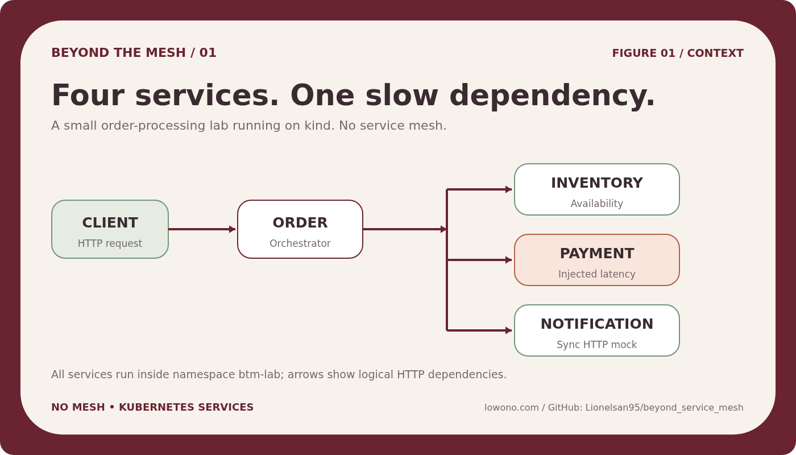
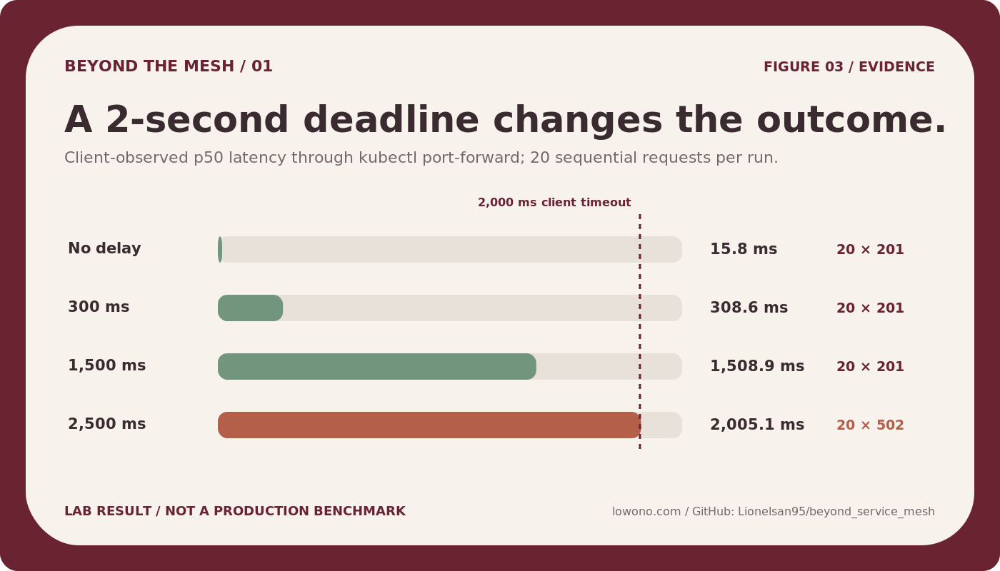
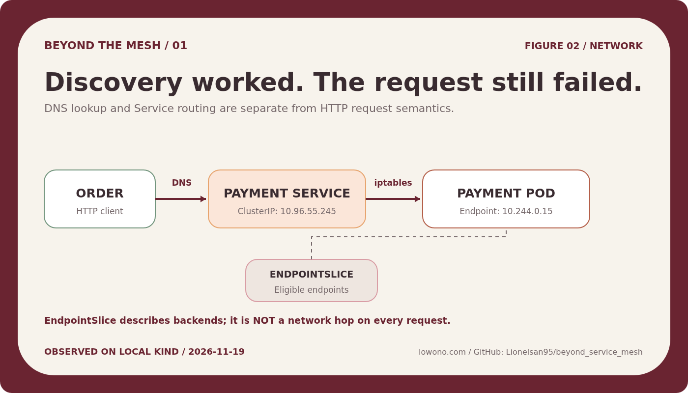
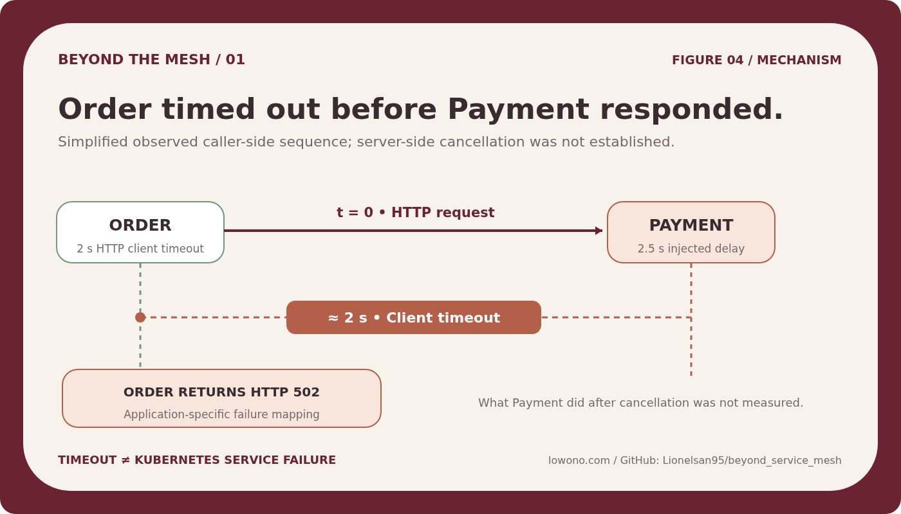

# Kubernetes Found the Service. Why Did the Request Still Fail?

*Beyond the Mesh · Part 1/8 — When Kubernetes is enough, and when it isn't*

**20 requests. 20 HTTP 502 responses.**

Every application Pod was running. The Services were reachable. Kubernetes had an eligible endpoint for Payment.

So why did every order request fail?

We didn't delete a Pod. We didn't break DNS. We added **2.5 seconds of delay** to a dependency in a small local Kubernetes lab.

What happened next is a useful reminder: **a network that delivers your request doesn't guarantee that your application can finish it.**

Before asking whether we need Istio—or any service mesh—let's follow the request and find the actual boundary.

## 1. The incident we deliberately created

Our test application has four lightweight Go HTTP services: **Order**, **Inventory**, **Payment**, and **Notification**. Order calls its dependencies over Kubernetes Services. The entire system runs in a single-node **kind** cluster, without sidecars or a mesh.


*Figure 1 — Baseline four-service topology in namespace `btm-lab` without a service mesh.*

The healthy baseline works. Then we inject latency into the mock Payment dependency, one request at a time. Order uses a **2-second HTTP client timeout** and doesn't retry.

We sent **20 sequential requests** for each scenario. Here is the outcome from our reproducible `2026-11-19-baseline` campaign:

| Payment delay | Responses observed | Median client latency |
|---|---|---:|
| None | 20 × HTTP 201 | 15.8 ms |
| 300 ms | 20 × HTTP 201 | 308.6 ms |
| 1,500 ms | 20 × HTTP 201 | 1,508.9 ms |
| 2,500 ms | 20 × HTTP 502 | 2,005.1 ms |


*Figure 3 — Local client-observed p50 latency and HTTP status distribution across the 2,000 ms client timeout boundary (`2026-11-19-baseline`, 20 sequential requests per run).*

At 300 and 1,500 ms, requests complete. At 2,500 ms, every response is HTTP 502, and the median observed latency sits near two seconds.

It looks like a Kubernetes failure from the caller's perspective. But that would be the wrong diagnosis.

## 2. Follow the request—not the buzzwords

Order reaches Payment using a DNS name like:

`payment-service.btm-lab.svc.cluster.local`

During the validated campaign, the **Payment Service ClusterIP** was `10.96.55.245` and the observed **Payment endpoint address** was `10.244.0.15`.

These addresses are not interchangeable. DNS resolves a Service name; Service traffic is directed toward eligible backend endpoints. An EndpointSlice *describes* those endpoints—it is not another network hop each request must traverse.

Our kind cluster used **kindnet** for Pod networking and **kube-proxy in iptables mode** for Service traffic handling.


*Figure 2 — Observed local Service discovery and endpoint routing (`2026-11-19-baseline`); EndpointSlice describes eligible backends rather than sitting in the packet path.*

That's a lot Kubernetes already handles: naming, virtual addressing and tracking eligible backends as Pods change.

But a Service doesn't know whether a payment is too slow for checkout. It cannot determine whether repeating the operation is financially safe. It doesn't set the deadline in Order's Go HTTP client.

**Kubernetes knew how to reach Payment. Order decided how long to wait.**

## 3. The request that ran out of time

Our injection asked Payment to delay its response by **2,500 ms**. Order was willing to wait **2,000 ms**.

The experiment therefore created a deliberate mismatch between the dependency's response time and its caller's deadline.


*Figure 4 — Observed caller-side timeout sequence; what Payment did after cancellation was not established.*

The observed result: **20 HTTP 502 responses out of 20 requests** at the 2,500 ms setting, with p50 client latency of **2,005.1 ms**.

That 502 isn't some automatic "Kubernetes timeout status." It is how **our Order application** maps the downstream call failure to its own HTTP response. Another application could expose a different status or error contract.

And we should not overclaim: these measurements establish what the caller observed. We didn't establish whether Payment continued processing after Order cancelled its call.

**Measurement note.** These are local, single-node kind experiments: 20 sequential calls per condition, measured by a client using `kubectl port-forward`. They're useful to illustrate a timeout boundary, **not** to benchmark Kubernetes throughput, production reliability or statistically robust tail latency.

## 4. Would adding a mesh fix it?

A popular response to slow dependencies is: "Add retries."

But consider the operation. What if a real payment succeeded and only its response got lost? Retrying without idempotency protection might duplicate a business action. Retrying an overloaded service can also make the overload worse.

**A proxy can retry an HTTP request. It cannot guarantee that repeating a business transaction is safe.**

A service mesh can be valuable when many teams need consistent traffic policies, workload identity, mTLS or service-to-service telemetry. It can move selected concerns out of individual applications into a managed data plane.

That change brings trade-offs: operating the data plane and control plane, resource overhead, policy ownership, incident diagnosis and new failure modes.

And a mesh does **not** make a 2.5-second dependency fit inside a 2-second deadline by magic. A different timeout might change the outcome; retries might help with transient errors; an asynchronous workflow might be more appropriate for a business transaction. Each is a different architectural decision.

Our lab has not installed a mesh or compared alternative implementations. **There is no measured mesh benefit to claim yet.**

## 5. An architecture decision, not a product decision

Before introducing another layer, separate the responsibilities:


*Figure 5 — Starting responsibility boundaries and the baseline decision to stay mesh-free until a concrete requirement justifies the cost.*

- **Kubernetes:** service naming, virtual addressing and eligible backend endpoint selection.
- **Application:** deadlines, business semantics, idempotency and context-aware recovery.
- **Proxy or service mesh:** potentially standardized traffic policies, workload identity and proxy-level telemetry, when the requirements justify it.

These are starting points, not mutually exclusive boxes. Libraries, gateways, CNIs and platform capabilities overlap in practice.

For **this** lab—four mock services, one local cluster, no demonstrated need for centralized security or traffic policy—our decision is to **keep the baseline mesh-free**.

We also ran a request-scoped payment failure experiment: **20/20 responses were HTTP 502**. Subsequent requests, without failure injection, produced **20/20 HTTP 201**. That demonstrates successful new requests after the injected condition is absent; it is **not** evidence of automatic self-healing.

The next architecture step is to introduce a specific additional requirement, test a potential solution, and compare its benefits against its cost.

**Don't install a mesh because you have microservices. Consider one because you have a problem it can demonstrably solve.**

## 6. Run the lab. Challenge the conclusion.

The application, manifests, experiment scripts and validation evidence live in the GitHub repository:

**[Beyond the Mesh — GitHub laboratory](https://github.com/Lionelsan95/beyond_service_mesh)**

From the repository root, after checking the prerequisites:

```bash
make doctor
make lab-up
SCENARIO_01_CAMPAIGN_ID=local-baseline make scenario-01-all
make validate-evidence
```

When finished:

```bash
make lab-down
```

The results in this article come from campaign **`2026-11-19-baseline`** ([manifest](../results/scenario-01/evidence/2026-11-19-baseline/manifest.json)) on **kind / Kubernetes v1.37.0**, with the recorded evidence snapshot. See the repository [README](../../README.md) for exact experiment parameters and reproducibility instructions.

**Next in Beyond the Mesh:** *Who Actually Controls Service-to-Service Traffic?* We'll trace a request through the data plane, then examine sidecars, control planes and ambient architectures—starting with the packet path, not the product names.

*Beyond the Mesh is an eight-part series about distributed systems, security, migrations and architecture decisions, backed by reproducible Kubernetes labs.*
